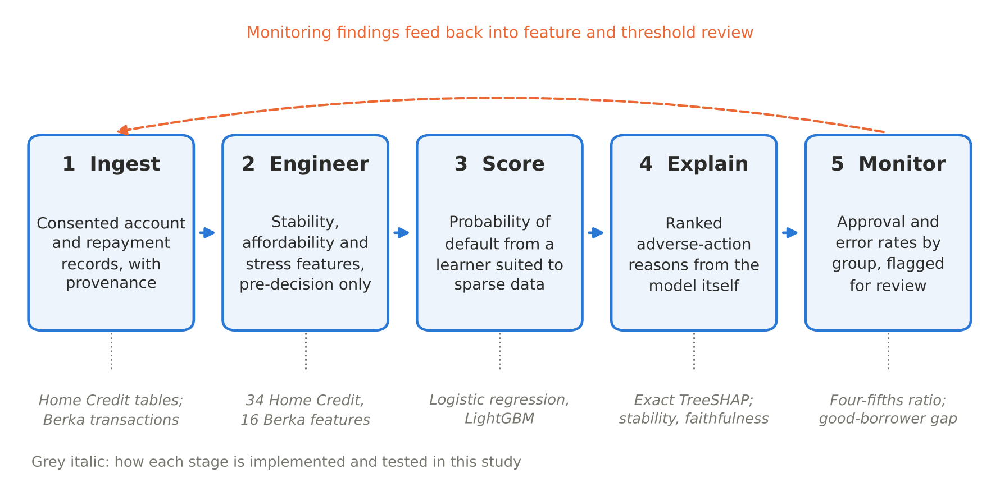

# Cash-Flow Explainable Underwriting (CFEU)

[](https://doi.org/10.5281/zenodo.24126177)

Reproducible code for the paper **"Does Cash-Flow Data See the Credit-Invisible? Evidence from Public Loan Data for an Explainable Underwriting Pipeline"** by Athresh Guruprakash (manuscript under preparation).

The study tests whether alternative data (repayment behaviour outside the credit bureau, and bank-account cash flow) improves credit scoring for applicants with little or no credit history, and what it does to explanation quality and fairness. Everything runs on two public datasets with real repayment outcomes.



## Main results

| Finding | Result |
| --- | --- |
| Gain from adding alternative data, all applicants (LightGBM AUC) | 0.734 → 0.765 |
| Gain for thin-file applicants with no bureau records (n = 44,020) | 0.687 → 0.748 |
| Defaults among approved thin-file applicants at a 70% approval rate | 6.7% → 5.5% |
| Berka: cash-flow features vs loan terms only (AUC) | 0.93 vs 0.66; above 0.89 in three robustness checks |
| Adverse-action reasons: same top reason across retrained models | 93% of declined applicants |
| Fixing the top reason vs a random feature: share of declines reversed | 56% vs 4% |
| Approval ratio, under-30s vs over-50s, thin-file applicants | 0.70 (bureau) → 0.62 (combined) |

Alternative data improves the scoring of the credit-invisible, most of all where bureau data is missing. It does not, on its own, make that scoring fairer, which is why the pipeline monitors outcomes by group.

## Data

The data is **not** included in this repository. The notebooks download it from the original sources.

| Dataset | Source | Terms |
| --- | --- | --- |
| Home Credit Default Risk (307,511 applications) | [Kaggle competition](https://www.kaggle.com/competitions/home-credit-default-risk) | Join the competition and accept its rules; the data may not be redistributed |
| Berka financial dataset, PKDD'99 (682 loans) | [CTU Prague Relational Learning Repository](https://relational.fel.cvut.cz/dataset/Financial), public read-only guest account | Cite Berka (1999) and Motl and Schulte (2015) |

## How to run

The notebooks are written for Google Colab and save their outputs to a `cfeu_journal` folder in your Google Drive.

1. **`notebooks/01_data_prep.ipynb`** downloads both datasets and builds the feature tables. You need a Kaggle API token (Kaggle → Settings → API → Generate New Token). About 20 minutes.
2. **`notebooks/02_models_evaluation.ipynb`** compares bureau, alternative and combined features with logistic regression and LightGBM, using repeated cross-validation, bootstrap confidence intervals, calibration and DeLong tests. About 30–45 minutes.
3. **`notebooks/03_explain_fairness_robustness.ipynb`** tests reason stability and faithfulness, fairness by gender and age, and the Berka robustness checks. About 20–30 minutes.
4. **`notebooks/04_worked_example.ipynb`** traces individual applicants through all five stages and computes the Berka account trajectories. About 10 minutes.
5. **`notebooks/05_robustness_extensions.ipynb`** runs nested cross-validation with hyperparameter search, overfitting checks on Berka (permutation test, learning curve, out-of-time test, shorter transaction windows), class-imbalance treatments (class weights, focal loss, undersampling, SMOTE), models without the undocumented external scores, and fairness mitigations for the age gap. About 75–100 minutes; each section saves to Drive as it finishes, so a disconnected run can resume.

Each notebook downloads a small JSON file of summary results. The versions used in the paper are in `results/`.

The same functions are available as a Python package in `src/cfeu/` (`features`, `models`, `explain`, `cases`) for use outside Colab:

```bash
pip install -r requirements.txt
```

```python
import sys; sys.path.insert(0, "src")
from cfeu.features import build_home_credit
from cfeu.models import run_suite, headline_table
```

## Repository layout

```
notebooks/   five Colab notebooks, run in order
src/cfeu/    feature building, models and evaluation, explanations and fairness, worked examples
results/     summary results used in the paper (counts, rates and metrics only)
figures/     figures in the paper
```

## Privacy

No individual records are stored or published. The worked examples round every value to two significant figures and keep no identifiers. Gender and age are used only to measure fairness and are never model inputs.

## Citation

If you use this code, please cite the paper (details in `CITATION.cff`) and the earlier conference version:

Guruprakash, A. (2027). Scoring the Unscored: Machine Learning and Alternative Data for Credit Accuracy in Payday and Earned Wage Lending. *Proceedings of IEEE SoutheastCon 2027* (accepted, to appear).

## Licence

Code: MIT (see `LICENSE`). Data remains under its original terms.
